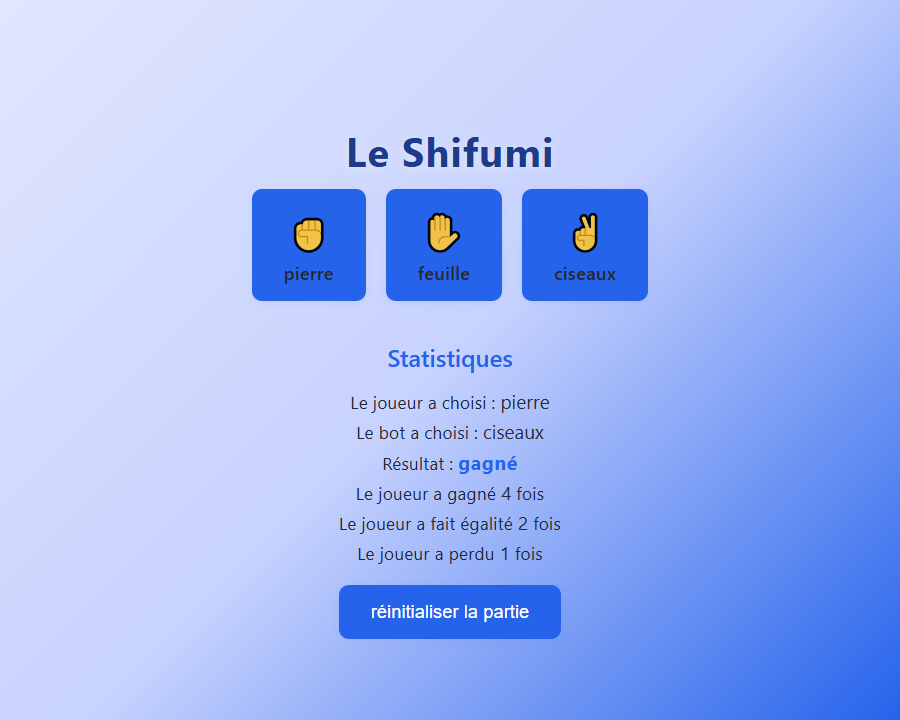

# Shifumi

Un pierre-feuille-ciseaux contre l'ordinateur, en HTML, CSS et JavaScript sans framework. C'est mon premier petit jeu web.

**[▶️ Jouer en ligne](https://starkiou.github.io/shifumi/)**

## Fonctionnalités

- Un clic sur pierre, feuille ou ciseaux joue une manche contre un choix aléatoire de l'ordinateur.
- Les deux choix et le résultat de la manche s'affichent, avec le total des victoires, égalités et défaites.
- Un bouton remet les compteurs à zéro sans recharger la page.

## Lancer en local

Aucune installation : cloner le dépôt et ouvrir `index.html` dans un navigateur.

## Licence

[MIT](LICENSE)
